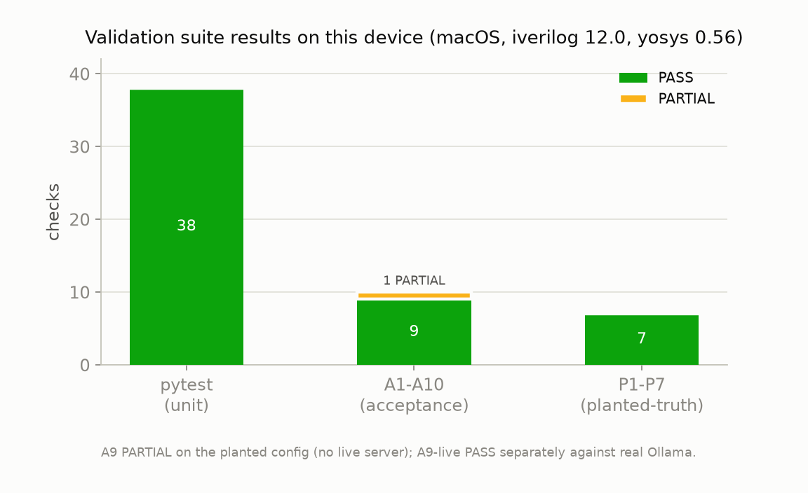
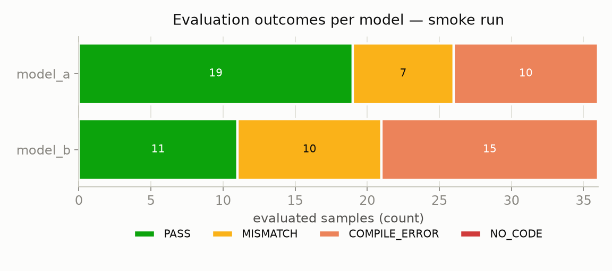
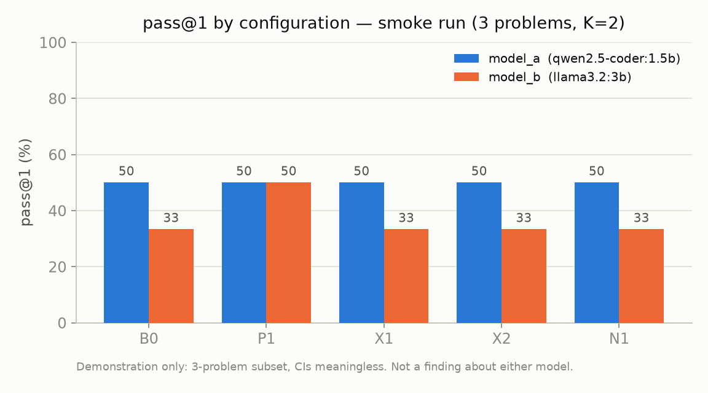

# Device test report — `rtlsens` harness on Apple Silicon

**Date:** 2026-10-30
**Machine:** Apple M1, 8 cores, 8 GB RAM; macOS 26.5.2 (Darwin 25.5.0), arm64.
**Toolchain:** Icarus Verilog 12.0 (stable), Yosys 0.56 (Homebrew) and Yosys 0.62 (via LibreLane `nix develop`), Python 3.13.7, Nix 2.33.
**Benchmark:** VerilogEval v2 `dataset_spec-to-rtl`, cloned and pinned at commit `c498220` (156 problems; frozen 60-problem subset in `configs/problem_subset.txt`).

This report records an independent reproduction of the harness on a machine different from the one in the original
`TEST_REPORT.md` (that run was Ubuntu 24.04, Yosys 0.33, Python 3.12). No real experiment was run: the real-model
numbers here come from a 3-problem **smoke test** with two small local models and are demonstrations of the
pipeline, not findings about any model.

---

## 1. Summary

| Area | Result |
|---|---|
| Unit tests (`pytest`) | **38 passed** |
| Acceptance A1–A10 | **9 PASS, 1 PARTIAL** (A9), exit code 0 |
| Planted-truth P1–P7 | **7 PASS** |
| Seed passthrough against real Ollama (A9-live) | **PASS** |
| Real-server smoke pipeline (`cli all`) | **completed**, 36 generations, 0 failed |
| LibreLane `nix develop` → Yosys | **Yosys 0.62**, harness `synth` ran under it |

The harness reproduces every historical check on this machine. The only non-PASS is A9, which is PARTIAL **by
design** when the planted config runs with no live model server; it was then confirmed PASS separately against a
live Ollama endpoint (Section 4).



---

## 2. Environment setup performed

```bash
cd past_history/llm-rtl-sensitivity
python3 -m venv .venv && source .venv/bin/activate
pip install -e ".[test]"
git clone https://github.com/NVlabs/verilog-eval third_party/verilog-eval
git -C third_party/verilog-eval checkout c498220d0a52248f8e3fdffe279075215bde2da6
```

Note: `environment/setup.sh` uses `apt-get` (Ubuntu). On macOS the tools come from Homebrew
(`brew install icarus-verilog yosys`) instead; the rest of the setup is identical.

---

## 3. Unit tests and acceptance

```
pytest -q                                                  -> 38 passed
python -m rtlsens.cli acceptance --config configs/experiment_planted.yaml
```

All checks reproduce the historical report, including the exact planted-truth z-scores:

- A1 preflight, A2 oracle (720/720 PASS), A3 negative controls, A4 eval determinism (identical SHA-256),
  A5 pytest (38 passed), A6 manifest, A7 count integrity (2,640/2,640 generations), A8 cache on/off,
  A10 fresh full chain (7/7 tables) — all **PASS**.
- A9 seed passthrough — **PARTIAL**: mock server distinguishes seeds; no real Ollama on the planted config.
- P1–P7 planted-truth — all **PASS** (e.g. P1 max |z| = 2.23 over 10 cells; P6 gate-count ratios exactly 1.0).

Stage timings on this machine (1 CPU): selftest evaluate 11.1 s, analyze 3.2 s.

**Yosys-version independence confirmed.** The original report used Yosys 0.33; this run used Yosys 0.56, and P6
(the gate-count chain) still passed with ratios exactly 1.0. P6 checks ratios, not absolute cell counts, so the
verdicts do not depend on the Yosys version.

---

## 4. Real-server checks (the path never tested before)

The historical report could not reach a model server, so the real-model path was untested. Here it was exercised
with two small models pulled into Ollama (chosen to stay under a 4 GB disk budget on this machine):

- `qwen2.5-coder:1.5b` (986 MB)
- `llama3.2:3b` (2.0 GB)

**A9-live — PASS.** Against the live endpoint `http://localhost:11434/v1`, the same seed returned byte-identical
text and seeds 1000 vs 1001 returned different text. This is the check that was only PARTIAL before.

**Smoke pipeline — `cli all` on `configs/experiment_smoke.yaml`** (3 problems: `Prob005_notgate`,
`Prob011_norgate`, `Prob012_xnorgate`; K = 2). All stages ran on real model output:

- generate: 36 generations, 0 failed; all `finish_reason = stop` (no truncation); latency mean 3.18 s/sample
  (min 0.63, max 11.56) on M1 CPU.
- evaluate: 72 rows. NO_CODE rate **0%** (both models produced fenced code; well under the 20% red-flag).
- synth: 24 rows. analyze: tables T1–T7 and figures F1–F4.
- determinism at T=0 (T6): raw identity 1.0 and outcome identity 1.0 for both models.

Outcome composition (extraction + compile + simulate):



pass@1 by configuration (demonstration only — 3 problems, confidence intervals meaningless):



> These pass@1 values are **not** a result about either model. With 3 problems and K = 2 the numbers are
> dominated by which gates happened to pass. The real study needs the full 60-problem subset at K = 10 on
> 7–8B models (see Section 6).

---

## 5. LibreLane / Yosys via Nix

```bash
nix develop github:librelane/librelane --command yosys -V      # -> Yosys 0.62
# harness synth stage run inside the LibreLane dev shell:
nix develop github:librelane/librelane --command bash -c \
  'source .venv/bin/activate && python -m rtlsens.cli synth --config configs/experiment_smoke.yaml'
```

This provides a pinned Yosys 0.62 (`/nix/store/.../bin/yosys`). The harness `synth` stage completed (24 rows).
For the three trivial reference designs in the smoke subset the cell counts were identical under Yosys 0.56 and
0.62 (1 cell each under Y0/Y1/Y2) — expected, since version/script sensitivity shows up only on arithmetic-heavy
designs, per `DESIGN.md` §11.

---

## 6. System requirements to run this application

### Minimum (harness validation only — no real model)

| Component | Requirement |
|---|---|
| OS | Linux (Ubuntu 24.04 tested) or macOS (Apple Silicon tested here). WSL2 on Windows. |
| Icarus Verilog | **12.x** (12.0 stable). VerilogEval does not support v13. |
| Yosys | any recent build for validation (0.33 / 0.56 / 0.62 all give identical verdicts). |
| Python | **≥ 3.11** (3.12 and 3.13 both tested). |
| Python packages | numpy, pandas, scipy, matplotlib, pyyaml, requests, pytest (installed by `pip install -e ".[test]"`). |
| Disk | ~1 GB (VerilogEval clone + venv). |
| Benchmark | VerilogEval cloned at the pinned commit `c498220`. |
| CPU/RAM | 1 CPU is enough; evaluation of the 60-subset is minutes. 8 GB RAM is comfortable. |

Validation needs no GPU and no network beyond the one-time VerilogEval clone and pip install.

### Additional for the real experiment (two LLMs on the 60-subset, K = 10)

| Component | Requirement |
|---|---|
| Model server | Ollama (or any OpenAI-compatible `/v1/chat/completions` endpoint). |
| Models | two 7–8B instruct/coder models from different families, roughly 4–5 GB each (≈ 8–10 GB total). |
| GPU | an 8 GB NVIDIA GPU is the design's assumption; Ollama uses it automatically. The full 2,640-generation run is ~5–10 h on one 8 GB GPU. **CPU-only is not feasible** for the full run (days); use the fallback levers in `NEXT_STEPS.md` §3.8 or an API model. |
| Disk | ~10 GB for two full-size models plus results. |

### Optional

| Component | Purpose |
|---|---|
| Nix (2.x, flakes enabled) | LibreLane toolchain via `nix develop github:librelane/librelane` for a pinned Yosys 0.62. The LibreLane dev shell is several GB in the Nix store. |

**On this machine specifically:** it has an Apple M1 (no NVIDIA GPU) and all APFS volumes share one container
with ~4–5 GB free. That is enough for harness validation and the small-model smoke test done here, but **not**
for the full real experiment (two 7–8B models + the full run). Run the real study on a Linux box with an 8 GB+
NVIDIA GPU and more free disk.

---

## 7. Files in this folder

- `TEST_REPORT_device.md` — this report.
- `summary_metrics.csv` — all headline numbers in one table (open in Excel/Sheets for graphs).
- `figures/fig1_pass_at_1.png` — pass@1 by configuration (smoke, demonstration).
- `figures/fig2_outcomes.png` — evaluation-outcome composition per model (smoke).
- `figures/fig3_suite.png` — validation-suite results on this device.

The smoke run's own tables and figures are under `results/smoke/` (T1–T7, F1–F4). The acceptance report is at
`results/acceptance_report.md`.
